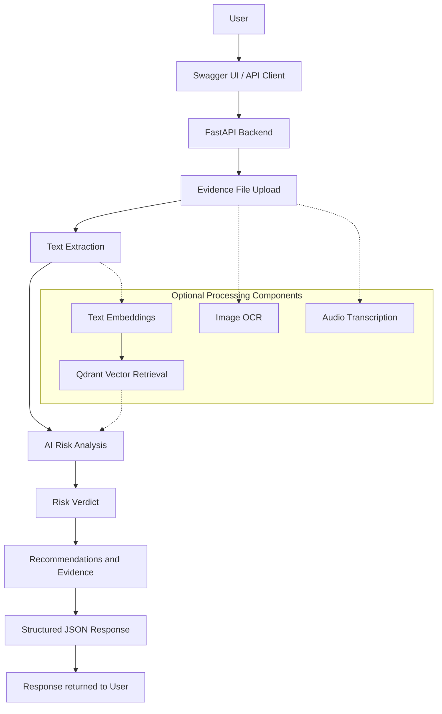

# 🛡️ ScamShield: AI-Powered Financial Scam Detection and Risk Analysis

ScamShield (FinFraud) is an AI-powered financial scam detection and risk analysis system designed to identify potential financial fraud from suspicious messages and digital evidence. It analyzes textual evidence, generates risk assessments, and provides actionable safety recommendations through a REST API.

The project uses FastAPI for backend services and integrates AI reasoning, with modular support for OCR, audio transcription, and vector-based scam retrieval.

## 🌟 Key Features

- **💬 Text-Based Scam Detection:** Analyzes chat logs, suspicious messages, and phishing attempts for common fraud indicators.
- **🤖 AI-Powered Risk Analysis:** Generates risk assessments and safety recommendations using an integrated LLM reasoning engine.
- **📊 Structured Risk Reports:** Returns risk probability, risk level, analysis, recommendations, and supporting evidence in JSON format.
- **📸 Image Processing Support:** Includes components for OCR and image analysis, subject to configuration and deployment resources.
- **🎙️ Audio Processing Support:** Includes integration with Groq Whisper for audio transcription.
- **🧠 Vector Database Integration:** Includes Qdrant components for scam similarity search and long-term memory.
- **🚀 REST API:** Provides a FastAPI endpoint for uploading evidence and retrieving analysis results.
- **📖 Interactive Swagger UI:** Enables API testing directly from a browser.
- **☁️ Live Deployment:** Hosted on Render for online demonstration.

> **Current deployment:** The free-hosted version is optimized for limited memory. OCR, image-risk classification, embedding search, and long-term vector-memory persistence are disabled in the deployed configuration. Text-based analysis is the primary tested workflow.

---

## 🚀 Live Demo

| Resource | Link |
|---|---|
| Live Backend | https://scamshield-finfraud.onrender.com/ |
| Swagger API Documentation | https://scamshield-finfraud.onrender.com/docs |
| OpenAPI Schema | https://scamshield-finfraud.onrender.com/openapi.json |
| GitHub Repository | https://github.com/pixelpilot007/ScamShield-FinFraud |

### How to Test the Live API

1. Open the [Swagger documentation](https://scamshield-finfraud.onrender.com/docs).
2. Expand `POST /analyze_risk/`.
3. Click **Try it out**.
4. Upload a text file using **Choose File**.
5. Click **Execute**.
6. Review the risk verdict, probability, analysis, and recommendations.

---


## 🏗️ System Architecture




The optional processing components represent the project's modular capabilities; they are not all active in the current free-hosted deployment.

---

## 🛠️ Technology Stack

| Category | Technologies |
|---|---|
| Programming Language | Python |
| Backend Framework | FastAPI |
| ASGI Server | Uvicorn |
| API Documentation | OpenAPI, Swagger UI |
| AI Reasoning | Google Gemini and Groq integrations |
| Audio Transcription | Groq Whisper integration |
| OCR and Image Processing | EasyOCR, Pillow |
| Vector Database | Qdrant |
| CLI | Rich, Typer, PyFiglet |
| Configuration | Python dotenv |
| Logging | Loguru |
| Testing | PyTest |
| Deployment | Render |

Some components are optional or disabled in the current hosted configuration.

---

## 📡 API Reference

### 1. Health Check

**Endpoint:** `GET /`

Checks whether the backend is responding and returns service information.

### 2. Analyze Risk

**Endpoint:** `POST /analyze_risk/`

Accepts evidence files using `multipart/form-data` and returns a structured risk assessment.

| Parameter | Type | Required | Description |
|---|---|---|---|
| `files` | File array | Yes | Evidence files submitted for analysis |

The primary tested input format is `.txt`.

### Example JSON Response

```json
{
  "inputs_processed": 1,
  "final_verdict": {
    "probability": 0.95,
    "risk_level": "High",
    "analysis": "Suspicious banking and OTP request indicators detected.",
    "recommendations": [
      "Do not click suspicious links.",
      "Never share your OTP.",
      "Verify the message through official bank channels."
    ],
    "sources": []
  },
  "detailed_evidence": {
    "visual_analysis": [],
    "text_matches": [],
    "aggregated_text": "Extracted input text",
    "memory_context": ""
  }
}
```

*This is an illustrative example. Actual results depend on the submitted evidence and AI analysis.*

---

## 🧪 Testing and Results

The deployed API was tested using two text files through Swagger UI. Both requests returned successful responses.

| Test Case | Expected Result | Observed Result | Status |
|---|---|---|---|
| Banking phishing message requesting an OTP | High risk | High, probability 0.95 | Pass |
| Normal team meeting message | Low risk | Low, probability 0.00 | Pass |
| File upload and processing | Successful | One input processed per request | Pass |

### Test 1: Scam Message

The test message contained urgent banking language, an account-blocking threat, and a request to verify an account and share an OTP.

**Observed result:** High Risk — 95%

The system identified phishing and bank-impersonation indicators and recommended avoiding suspicious links, protecting the OTP, and contacting the bank through official channels.

### Test 2: Normal Message

The test message contained a routine team meeting confirmation and an agenda reminder.

**Observed result:** Low Risk — 0%

The system classified the message as ordinary professional communication without suspicious indicators.


*These results validate two sample cases only. They do not establish overall detection accuracy or guarantee correct classification of unseen messages.*

---

## 📁 Project Structure

```text
fin-fraud-main/
├── fin_fraud/
│   ├── config.py
│   ├── features.py
│   ├── ingest_images.py
│   ├── llm.py
│   ├── logic.py
│   └── main.py
├── data/
├── docs/
├── tests/
├── assets/
│   └── final-testing-results.png
├── run_cli.py
├── requirements.txt
├── pyproject.toml
├── Makefile
└── README.md
```

Some optional directories or data files may not be included in every deployment or repository checkout.

---

## ⚙️ Local Setup

### Prerequisites

- Python 3.11 or a compatible Python version
- Git
- API keys for the AI providers you choose to use

### Step 1: Clone the Repository

```bash
git clone https://github.com/pixelpilot007/ScamShield-FinFraud.git
cd ScamShield-FinFraud
```

### Step 2: Create a Virtual Environment

```bash
python -m venv .venv
```

Activate it on macOS or Linux:

```bash
source .venv/bin/activate
```

On Windows PowerShell:

```powershell
.venv\Scripts\Activate.ps1
```

### Step 3: Install Dependencies

```bash
python -m pip install --upgrade pip
pip install -r requirements.txt
```

### Step 4: Configure Environment Variables

Create a `.env` file in the project root:

```env
GOOGLE_API_KEY=your_google_api_key
GROQ_API_KEY=your_groq_api_key
LLM_PROVIDER=gemini
USE_CLOUD=False
```

Configure additional Qdrant settings if you enable cloud-based vector retrieval.

**Security:** Never commit API keys or your `.env` file to GitHub.

### Step 5: Start the Backend

```bash
uvicorn fin_fraud.main:app --reload --port 8000
```

Open the local API documentation:

http://127.0.0.1:8000/docs

---

## 🔑 External Services

- **Google AI Studio:** https://aistudio.google.com/
- **Groq Console:** https://console.groq.com/keys
- **Qdrant Cloud:** https://cloud.qdrant.io/

Configure only the services required by the features you intend to enable. Provider quotas, rate limits, and billing requirements may apply.

---

## ⚠️ Deployment Limitations

- The hosted application is optimized for a free-tier environment with limited memory.
- Local OCR and image-risk classification are disabled in the deployed configuration.
- Embedding-based scam search and long-term vector-memory persistence are disabled in the deployed configuration.
- Audio transcription and other integrations depend on implementation, API keys, and provider availability.
- Risk scores are AI-generated assessments and should not be treated as calibrated probabilities of actual fraud.
- Two successful test cases are not sufficient to establish overall model accuracy.

---

## 🔮 Future Improvements

- Re-enable OCR and image analysis using a memory-efficient deployment.
- Restore Qdrant-based similarity search and long-term memory.
- Expand the labelled test dataset with legitimate, fraudulent, and ambiguous messages.
- Evaluate precision, recall, F1-score, and confusion matrix.
- Build a dedicated frontend for evidence upload and report visualization.
- Add automated API tests for validation, error handling, and different file types.

---

## 🤝 Contributing

1. Fork the repository.
2. Create a feature branch.
3. Commit your changes.
4. Push the branch to GitHub.
5. Open a pull request.

---

## 📄 License

Add the applicable license and dataset attribution information before distributing the project.

---

## ⚖️ Disclaimer

ScamShield is an educational and demonstration project. Its assessments may be incorrect or incomplete and should not replace professional fraud investigation. Always verify suspicious financial communications through official channels before taking action.
