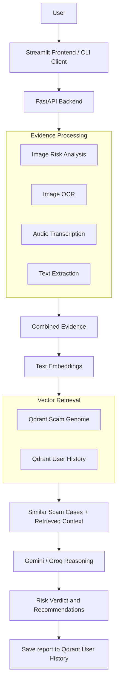
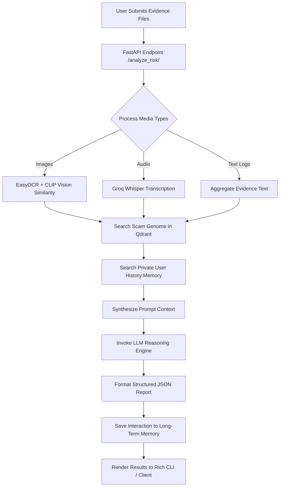

# 🛡️ ScamShield: AI-Powered Financial Scam Detection and Risk Analysis

A modular financial scam detection and multimodal evidence analysis system built with FastAPI, a Rich-powered CLI, Qdrant Vector Database, EasyOCR, Groq Whisper, and Google Gemini 2.0 Flash / Groq Llama 3.

---

## ✅ Overview & Key Features

**FinFraud** is a production-grade **Multimodal Financial Fraud Detection & Risk Analysis System** built to handle multi-format evidence ingestion (screenshots, audio recordings, chat logs), vector similarity search, and automated LLM risk evaluation.

### 🌟 Core Features

- **📸 Multimodal Visual Evidence OCR:** Extracts embedded text from suspicious screenshots, fake payment receipts, and crypto trading dashboards using EasyOCR and CLIP embeddings (`clip-ViT-B-32`).
- **🎙️ Speech-to-Text Audio Transcription:** Converts voice notes, fake customer support calls, and audio recordings to text via Groq Whisper Large v3.
- **💬 Text & Chat Log Inspection:** Analyzes raw chat logs, phishing emails, and social media transcripts for fraudulent patterns.
- **🧠 Vector Search & Scam Genome RAG:** Integrates Qdrant Vector Database to query a pre-populated "Scam Genome" collection (Pig Butchering, Tech Support scams, Crypto Ponzi schemes).
- **🔒 Long-Term Memory Context:** Maintains a dedicated private `user_history` vector store to detect recurring fraudulent entities across sessions.
- **🤖 Dual-LLM Reasoning Engine:** Flexible risk evaluation powered by **Google Gemini 2.0 Flash** or **Groq Llama-3.3-70B Versatile** to output structured JSON risk assessments and safety recommendations.
- **💻 Rich Interactive CLI & REST API:** High-throughput FastAPI asynchronous backend coupled with an interactive Rich terminal interface.

---

## 🛠️ Architecture Design



---

## 🛠 Tech Stack

| Category | Technologies Used |
|---|---|
| Frontend / CLI | Rich CLI, PyFiglet, Typer |
| Backend Server | FastAPI, Uvicorn |
| Vector Database | Qdrant (Cloud Cluster & Local Mode) |
| Computer Vision & OCR | EasyOCR, CLIP (`clip-ViT-B-32`), SentenceTransformers |
| Audio Processing | Groq (Whisper Large v3) |
| AI Frameworks & LLMs | Google Generative AI (Gemini 2.0 Flash), Groq Llama-3.3-70B |
| Environment & Management | Python 3.11+, `uv` Package Manager, PyTest, Loguru |

---

## 📡 API Reference

### 🛡️ Fraud Detection & System Endpoints

| Method | Endpoint | Required Parameters | Optional Parameters | Description |
|:---:|:---:|:---:|:---:|:---|
| **GET** | `/` | `None` | `None` | Health check endpoint returning backend operational status and Qdrant execution mode (`Cloud` vs `Local`). |
| **POST** | `/analyze_risk/` | `files` | `None` | Accepts multi-part evidence files (`.png`, `.jpg`, `.mp3`, `.wav`, `.txt`), extracts OCR & audio transcripts, searches Qdrant Scam Genome & Long-Term Memory, and returns structured LLM risk verdict with actionable safety steps. |

---

## 🗄️ Vector Database Schema Design

FinFraud uses **Qdrant Vector Database** collections to index multi-tenant scam genome patterns and maintain long-term memory across analysis requests.

```
    ┌─────────────────────────────────────────────────────────────┐
    │                    Qdrant Vector Store                      │
    ├──────────────────────────────┬──────────────────────────────┤
    │         Scam Genome          │         user_history         │
    │  (Public Fraud Datasets)     │      (Long-Term Memory)     │
    ├──────────────────────────────┼──────────────────────────────┤
    │ id: Integer / UUID           │ id: UUID                     │
    │ vector: 768/1024-dim Dense   │ vector: 768-dim BGE Dense    │
    │ distance: Cosine             │ distance: Cosine             │
    └──────────────┬───────────────┴──────────────┬───────────────┘
                   │                              │
                   ▼                              ▼
          [Payload Metadata]             [Payload Metadata]
          - original_text                - timestamp
          - risk_label (scam/legit)      - original_input
          - scam_type                    - verdict_summary
          - category / filename          - recommendations
```

### 1. `Scam Genome` Payload Schema

```json
{
  "id": 10001,
  "vector": [0.0241, -0.0512, 0.1189, "..."],
  "payload": {
    "text": "Type: scam_scripts
Personality: unknown
Dialogue:
Send 0.5 BTC to unlock trading pool...",
    "original_text": "Send 0.5 BTC to unlock trading pool...",
    "category": "ground_truth",
    "risk_label": "scam",
    "scam_type": "scam_scripts",
    "personality": "unknown",
    "description": "Pig Butchering scam pattern dataset snippet",
    "filename": "fake_crypto_dashboard.png"
  }
}
```

### 2. `user_history` Long-Term Memory Payload Schema

```json
{
  "id": "e4b21b9c-8512-4c21-bdf4-97216a759082",
  "vector": [-0.0124, 0.0891, 0.0412, "..."],
  "payload": {
    "timestamp": "2026-08-07T00:38:00.000Z",
    "original_input": "Chat Log: Deposit funds to secure account before withdrawal...",
    "verdict_summary": "High Risk (94%)",
    "recommendations": [
      "Refrain from transferring any digital assets or fiat currency.",
      "Block the sender and report to relevant financial fraud authority."
    ]
  }
}
```

---

## 🧠 Key System Components & Use Cases

* **FastAPI Backend Server:** Serves as the core REST API engine (`/analyze_risk/`), routing evidence payloads, processing file buffers, querying vector indices, and invoking LLM reasoning engines.
* **EasyOCR & CLIP Vision Pipeline:** Processes uploaded screenshots and images, extracting optical text and generating 512-dimensional CLIP visual vectors padded to match vector schema.
* **Groq Whisper Audio Engine:** Transcribes `.mp3`, `.wav`, `.m4a`, and `.ogg` audio recordings in real-time with zero-shot accuracy.
* **Qdrant Vector Database:**
  * **Scam Genome Collection:** Stores known fraud vectors (Pig Butchering scripts, fake banking dialogs, scam screenshots) for cosine similarity matching.
  * **User History Collection:** Persists interaction embeddings and previous risk verdicts to build persistent session memory.
* **Multi-LLM Reasoning Dispatcher:** Synthesizes aggregated visual, textual, and audio evidence against retrieved vector context to generate probabilistic risk scores (`High`, `Medium`, `Low`), evidence breakdowns, and actionable safety steps.

---

## 📁 Directory Structure

```
Fin-Fraud/
├── fin_fraud/              # Core Source Package
│   ├── config.py           # Configuration & Settings Manager
│   ├── features.py         # Text Ingestion & BGE Embedding Engine
│   ├── ingest_images.py    # Vision Embedding Ingestion to Qdrant
│   ├── llm.py              # Multimodal LLM Reasoning (Gemini / Groq)
│   ├── logic.py            # Image Similarity & Risk Rules
│   └── main.py             # FastAPI REST Server
├── data/                   # Raw & Processed Fraud Datasets
│   ├── raw/                # Scam & Legit Text Collections
│   └── images/             # Scam & Legit Screenshot Evidence
├── docs/                   # Documentation & MkDocs Configuration
├── tests/                  # Test Suite & Verification Scripts
├── assets/                 # Screenshots & Visual Assets
├── run_cli.py              # Interactive Rich CLI Entrypoint
├── requirements.txt        # Dependencies Manifest
├── pyproject.toml          # Project Configuration
├── Makefile                # Shortcut Automation Commands
└── README.md               # Documentation
```

---

## ⚙️ Setup & Credentials Guide

Follow these steps to set up API keys and databases:

### 1️⃣ Google AI Studio (Gemini Key)

1. Sign in to [Google AI Studio](https://aistudio.google.com/).
2. Click **Create API Key** and copy the string.
3. Save it in your `.env` as `GOOGLE_API_KEY`.

### 2️⃣ Groq Console (Groq Key)

1. Sign in to [Groq Console](https://console.groq.com/keys).
2. Click **Create API Key** and copy the string (`gsk_...`).
3. Save it in your `.env` as `GROQ_API_KEY`.

### 3️⃣ Qdrant Cloud (Vector Database)

1. Sign up on [Qdrant Cloud](https://cloud.qdrant.io/).
2. Create a **Free Tier Cluster**.
3. Copy your **Cluster URL** and **API Key**.
4. Set `USE_CLOUD=True`, `QDRANT_CLOUD_URL`, and `QDRANT_API_KEY` in `.env`.

### 4️⃣ Local Environment Setup

```bash
# Clone repository
git clone https://github.com/RishavJ7/fin-fraud.git
cd fin-fraud

# Create virtual environment using uv
uv venv --python 3.11

# Activate virtual environment
# Windows PowerShell:
.venv\Scripts\Activate.ps1
# Linux / macOS:
source .venv/bin/activate

# Install dependencies
uv pip install -r requirements.txt
```

---

## 🚀 Usage Guide / How to Use

Follow this workflow to run the system:

1. **Populate Vector Database:**
   ```bash
    # Ingest text scam dataset into Qdrant
    python -m fin_fraud.features --recreate

    # Ingest image evidence into Qdrant
    python -m fin_fraud.ingest_images
   ```
2. **Start FastAPI Backend Server:**
   ```bash
    uvicorn fin_fraud.main:app --reload --port 8000
   ```

    *Access API documentation at* `http://localhost:8000/docs`
3. **Run Interactive CLI Application:**

   In a separate terminal:
   - Provide file paths to suspect evidence (images, audio notes, or text logs).
   - Review the detailed Risk Verdict, Database Matches, and Recommended Actions.

---

## 🔐 Environment Variables (`.env`)

| Key | Description |
|---|---|
| `USE_CLOUD` | Set `True` to use Qdrant Cloud or `False` for local Qdrant |
| `QDRANT_CLOUD_URL` | Qdrant Cloud Cluster URL |
| `QDRANT_API_KEY` | Qdrant Cloud API Key |
| `LLM_PROVIDER` | Choose reasoning provider (`gemini` or `groq`) |
| `GOOGLE_API_KEY` | Google Gemini 2.0 API Key |
| `GROQ_API_KEY` | Groq LPU API Key |

---

## 💬 Detection & Reasoning Flow



---

## 🤝 Contributing

1. Fork the repository
2. Create a feature branch (`git checkout -b feature/new-feature`)
3. Commit your changes (`git commit -m 'Add new feature'`)
4. Push to the branch (`git push origin feature/new-feature`)
5. Open a Pull Request 🎉

---
